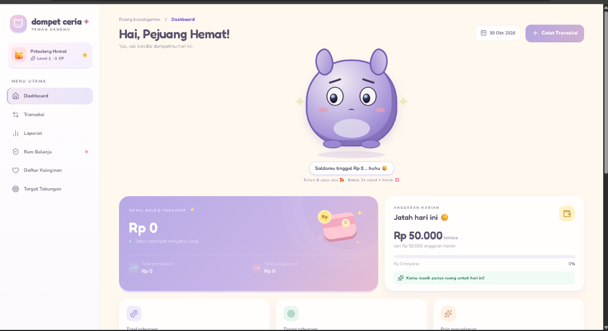

# 💜 Dompet Ceria

<p align="center">
  Kelola Keuangan, Wujudkan Impian!
  DAMN BROww
</p>

<p align="center">
  Website pengelolaan keuangan dengan tampilan sederhana dan modern.
</p>

---

## ✨ Tentang Dompet Ceria

**Dompet Ceria** adalah proyek website yang dikembangkan untuk menghadirkan pengalaman pengelolaan keuangan melalui antarmuka yang sederhana, menarik, dan mudah digunakan.

Dengan konsep tampilan yang bersih serta sentuhan warna ungu, Dompet Ceria dirancang untuk menjadi platform pengelolaan keuangan yang nyaman digunakan.

## 🎨 Tampilan Proyek

<p align="center">
  
</p>

## 🛠️ Teknologi

| Teknologi | Keterangan |
|---|---|
| ⚛️ React | Library untuk membangun antarmuka |
| ⚡ Vite | Build tool dan development server |
| 🎨 CSS | Mengatur tampilan website |
| 🟨 JavaScript | Bahasa pemrograman |

## 🚀 Menjalankan Proyek

Ikuti langkah berikut ya untuk menjalankan Dompet Ceria di komputer lokal.

**1. Clone repository**
```bash
git clone URL_REPOSITORY
```

**2. Masuk ke folder proyek**
```bash
cd dompet-ceria
```

**3. Instal dependensi**
```bash
npm install
```

**4. Jalankan aplikasi**
```bash
npm run dev
```

**5. Buka aplikasi**

Akses alamat lokal yang muncul di terminal, biasanya:
`http://localhost:5173`

## 📁 Struktur Folder

```text
dompet-ceria/
├── public/
├── src/
│   ├── assets/
│   ├── App.jsx
│   ├── App.css
│   ├── index.css
│   └── main.jsx
├── index.html
├── package.json
├── vite.config.js
└── README.md
```

## 📌 Perintah Tersedia

```bash
npm run dev      # Menjalankan development server
npm run build    # Build aplikasi
npm run preview  # Preview hasil build
npm run lint     # Memeriksa kualitas kode
```

---

<p align="center">
  Dibuat dengan 💜 menggunakan React dan Vite.
</p>

<p align="center">
  Dompet Ceria — Small Steps, Better Finances.
</p>
